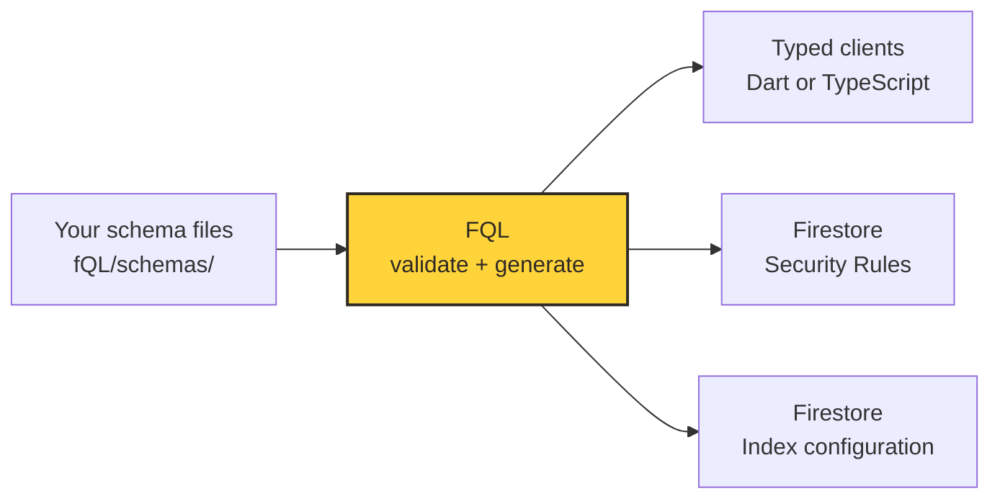

<p align="center">
  
</p>

<h1 align="center">FQL — Firestore Query Language</h1>

<p align="center">
  <strong>Your Firestore schemas. Typed clients. One generation step.</strong>
</p>

<p align="center">
  <a href="#install-the-cli">Install</a> ·
  <a href="#quickstart">Quickstart</a> ·
  <a href="docs/README.md">User handbook</a> ·
  <a href="docs/schemas.md">Write a schema</a> ·
  <a href="docs/enforcement.md">Enforcement boundaries</a>
</p>

---

FQL turns schema files into a typed Dart or TypeScript client for Cloud Firestore, plus Security Rules and index configuration. Define your document fields, constraints, and access policies once; use generated models, builders, and typed queries in your application.

The developer experience is inspired by Ent. FQL runs during development or CI; your app uses the official Firebase SDK without an FQL server or an extra FQL runtime package.



## What can I do with it?

| You define | FQL gives you |
| --- | --- |
| Models in separate `.fql` files | Typed models and collection repositories |
| Field types, required/optional values, defaults, and bounds | Validation before writes and when decoding reads |
| Enums, embedded objects, and bounded lists | Typed values and recursive validation |
| Access policies and protected fields | Reviewable Firestore Security Rules |
| Supported composite indexes | A generated Firestore index configuration |
| Data operations in your app | Create, read, update, delete, queries, pagination, listeners, batches, and transactions |

**Status: 0.1 development release.** Dart/Flutter and TypeScript targets are implemented. TypeScript uses the modular Firebase JavaScript SDK, including in React Native/Expo; it does not accept `@react-native-firebase` instances, and this SDK has no Firestore persistent caching in React Native. See [target compatibility](docs/typescript.md) and [verification evidence](docs/verification.md).

FQL preserves Firestore's data model: it does not provide joins, foreign keys, uniqueness guarantees, or data migrations. Generated clients are not a security boundary; deployed Rules enforce supported constraints and client authorization. Admin/server SDKs bypass Rules. Read the [enforcement boundaries](docs/enforcement.md) before integrating.

## Find your way

| I want to… | Start here |
| --- | --- |
| Get from installation to my first document | [Quickstart below](#quickstart) |
| Define models, fields, defaults, and permissions | [Schema guide](docs/schemas.md) |
| Read, update, query, paginate, or listen to data | [Data operations](docs/data-operations.md) |
| Generate, deploy, change schemas, or fix an error | [Project workflow and troubleshooting](docs/workflow.md) |
| Use claims, reusable policies, or related-document checks | [Authorization reference](docs/authorization.md) |
| Browse all guides and reference material | [User handbook](docs/README.md) |
| Run a complete local example | [Flutter emulator example](examples/flutter/README.md) |
| Work on the compiler or publish a release | [Contributor guide](CONTRIBUTING.md) |

## Install the CLI

On macOS or Linux, no Go installation is required:

```sh
curl -fsSL https://raw.githubusercontent.com/jonace-mpelule/fQL/main/install.sh | sh
fql version
```

The installer selects your OS/CPU, verifies the archive checksum and executable version, and installs into `~/.local/bin`. Follow its printed PATH command for the current terminal if needed. It never uses sudo. You can also download a binary from [GitHub Releases](https://github.com/jonace-mpelule/fQL/releases).

Run the installer again to upgrade. It prefers a stable release, falling back to the newest published preview when none exists. To pin a published version, use `sh -s -- --version VERSION` instead of `sh`, replacing `VERSION` with the release version. Add `--no-modify-path` to manage PATH yourself. Windows distribution is currently outside the release scope.

## Quickstart

This walkthrough uses the `Message` and `User` models scaffolded by `fql init`. Choose one target for your existing app and run the CLI commands from the app's root directory.

### 1. Set up Firebase and choose your target

You need a Firebase project with a Cloud Firestore database and Firebase Authentication configured for your app. FQL does not create the Firebase project, initialize the SDK, or sign users in.

**Dart / Flutter**

Follow the official [Flutter Firebase setup](https://firebase.google.com/docs/flutter/setup), then add the application dependencies and scaffold FQL:

```sh
flutter pub add firebase_core cloud_firestore firebase_auth
fql init --target dart
```

**TypeScript / React Native / Expo**

Follow the official [Firebase JavaScript setup](https://firebase.google.com/docs/web/setup), then:

```sh
npm install firebase
fql init --target typescript
```

These are alternatives: do not run both init commands in the same project. Init creates configuration and sample schemas; it refuses to overwrite existing files. See [project configuration](docs/workflow.md#configure-paths-and-targets) for an existing FQL project.

### 2. Define a schema

Open `fQL/schemas/messages.fql`. The scaffold already contains this working model; edit it as your application evolves:

```fql
schema "0.1"

model Message {
  collection = "messages"
  fields {
    ownerId string.required().immutable()
    body string.required().minLength(1).maxLength(4000)
    createdAt timestamp.required().immutable()
    priority int.required().min(0).max(10).default(0)
  }
  access {
    read = owner(ownerId)
    create = owner(ownerId)
    update = owner(ownerId)
    delete = owner(ownerId)
  }
  indexes {
    index(ownerId.asc, createdAt.desc)
  }
}
```

This defines documents in `messages`: an immutable owner UID, a nonempty body, a caller-supplied immutable timestamp, and a priority from 0 to 10 that defaults to 0 on create. String length bounds count UTF-8 bytes. The document ID is generated metadata, not a declared field.

Only the signed-in owner may access each document. Queries must include the owner's UID; Rules do not filter other users' documents out for you. The index supports the owner-and-time query below. For server-generated timestamps, use [managed timestamp fields](docs/schemas.md#use-server-generated-timestamps) instead.

Add more models in separate files under `fQL/schemas/`. Every file starts with `schema "0.1"`; files in nested directories compile together. Both `.fql` and `.fQL` are supported. Learn how to choose types, model optional values, and add permissions in the [schema guide](docs/schemas.md).

### 3. Validate and generate

```sh
fql format
fql validate
fql generate
```

The default layout after generation is:

```text
fQL/
  fql.config                         # Target and project paths
  fql.lock                           # Generated compatibility and artifact metadata
  schemas/
    users.fql                        # Your schema sources
    messages.fql
lib/data/fql/fql.dart                 # Dart target
src/data/fql/fql.ts                   # TypeScript target (alternative to Dart)
firebase/generated/
  firestore.rules
  firestore.indexes.json
```

You get the client for your selected target, not both. Commit the schemas, configuration, lockfile, and generated artifacts. Edit the schemas and regenerate instead of editing generated files.

### 4. Load the rules and indexes

Generating files does not deploy them. Before using the app against a hosted database, review the generated Rules and indexes, point your Firebase configuration at them, and explicitly deploy them. The [deployment walkthrough](docs/workflow.md#deploy-rules-and-indexes) includes the `firebase.json` configuration and commands.

For a local-only first run, use the [runnable emulator example](examples/flutter/README.md), which supplies synthetic Firebase configuration, sign-in, and a Flutter UI. A successful local run does not establish deployed security or native-device behavior.

### 5. Create and read a document

These examples belong in an asynchronous application function after Firebase initialization and sign-in. Pass `uid`, the authenticated user's UID; an arbitrary string will not satisfy the ownership policy. Dart imports assume a file under `lib/`; TypeScript imports assume a file under `src/`.

**Dart / Flutter**

```dart
import 'package:cloud_firestore/cloud_firestore.dart';
import 'data/fql/fql.dart';

Future<void> createMessage(String uid) async {
  final db = FqlClient(FirebaseFirestore.instance);
  final message = await db.messages.create()
      .setOwnerId(uid)
      .setBody('Hello from FQL')
      .setCreatedAt(Timestamp.now())
      .save();

  final snapshot = await db.messages.get(message.id);
  print(snapshot.data.body);
  print(snapshot.data.priority); // 0: create default
}
```

**TypeScript**

```ts
import { getFirestore, Timestamp } from 'firebase/firestore';
import { FqlClient } from './data/fql/fql';

export async function createMessage(uid: string) {
  const db = new FqlClient(getFirestore()); // Uses your initialized default app.
  const message = await db.messages.create()
    .setOwnerId(uid)
    .setBody('Hello from FQL')
    .setCreatedAt(Timestamp.now())
    .save();

  const snapshot = await db.messages.get(message.id);
  console.log(snapshot.data.body);
  console.log(snapshot.data.priority); // 0: create default
}
```

The scaffold also defines `User` with document-ID ownership. To create a profile, use `db.users.create(id: uid).setName('Alex').save()` in Dart or `db.users.create(uid).setName('Alex').save()` in TypeScript. Explicit-ID creates are create-only transactions: they read for existence, need connectivity and read permission, and fail when the document already exists. Use an update for an existing profile.

### 6. Update, query, and listen

Continue with [data operations](docs/data-operations.md) for examples in both languages: partial updates, null versus removal, deletes, owner-scoped queries, pagination, live listeners with cleanup, batches, transactions, and error handling.

For the Message model above, your first query is `db.messages.query().where(MessageFields.ownerId.eq(uid))`. Add ordering and a limit, then use `.all()` for a one-time result or `.watch()` for live changes. Dart watches return streams; TypeScript watches take success/error callbacks and return an unsubscribe function. The guide shows both complete forms.

## The everyday workflow

After editing schema files:

```sh
fql format
fql validate
fql diff
fql generate
fql generate --check
```

Review `diff` before generation, which advances its comparison baseline. Regeneration changes code and Firebase artifacts; it does not change stored documents. Review compatibility with existing data and older app versions, test the resulting rules, and explicitly deploy changed rules/indexes. Use `fql generate --check` in CI to detect stale or missing generated output without writing files.

For command options, configuration, schema evolution, audits, and common errors, see [project workflow](docs/workflow.md). For all supported features and their detailed contracts, browse the [user handbook](docs/README.md).
